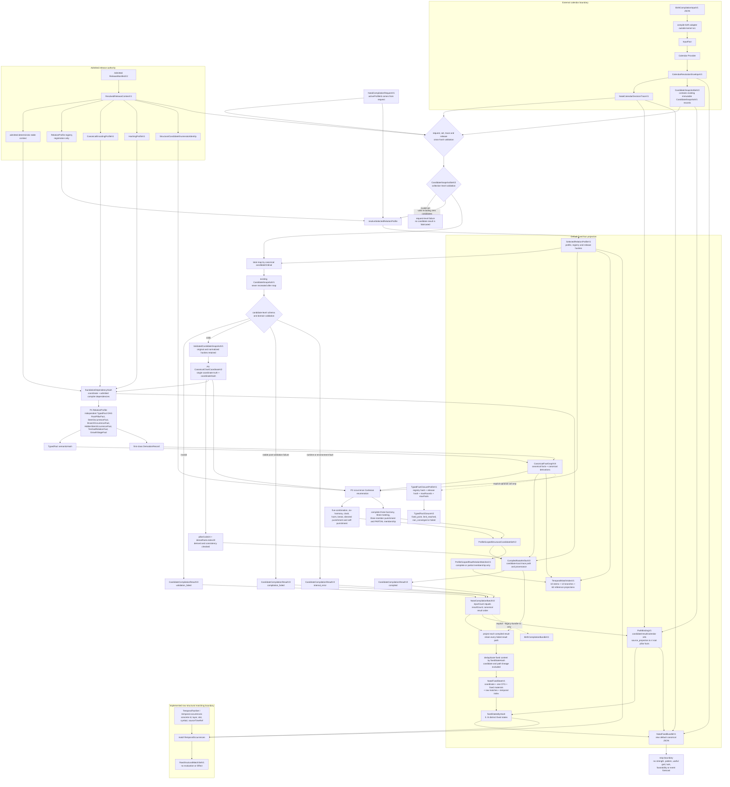
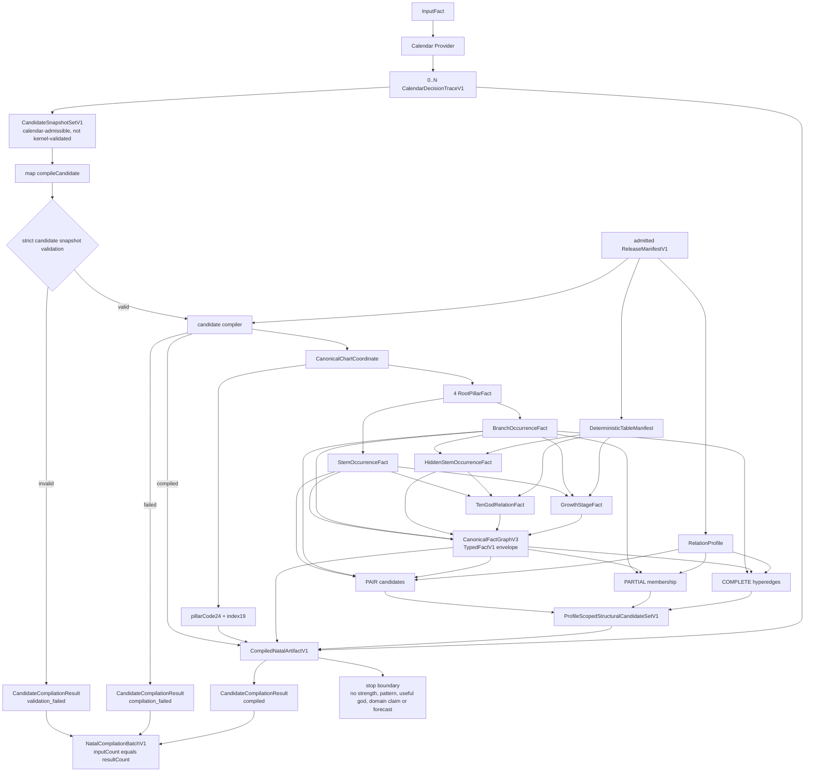
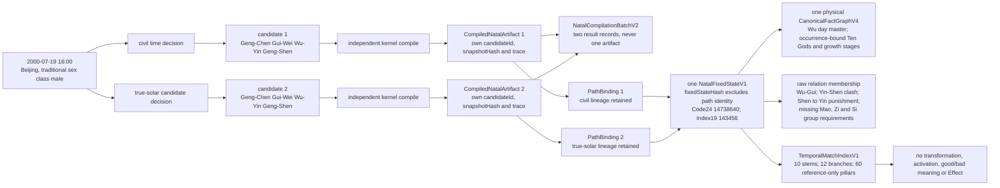

# Bazi-Centric Formal State Kernel core contract

The v0.7.2 release admits relation profile v4: Zi-Mao punishment is reciprocal.
Raw pair materials mark `punishmentDirection.kind` as `bidirectional` for this
pair; P2 emits two distinct directed candidates. Temporal indices and inter-layer
matching enumerate both declared directed rows. The five-bit pair mask still
records presence only, never direction or the number of witnesses. See
`docs/MIGRATION-RELATION-V4.md` for rebuilding historical outputs.

This contract describes one pipeline:

deterministic fact compilation -> versioned knowledge interpretation ->
branched rule judgment -> trusted admission -> one state calculus ->
complete traceability.

Sections 1 to 13 define architecture and invariants; they include future rule
contracts, not a claim that the entire pipeline executes today. Section 30 is
the current implementation and migration index. Sections 26 to 28A define
current identities and cardinalities, and `TIME_CORE.md` defines the temporal
runtime. Sections explicitly labelled retired or historical are non-normative
migration context and must not be used as current API examples.

## 1. Authority

The kernel is Bazi-first. It receives a trusted, already-calculated
`BaziChartSnapshotV1` or `BaziChartSnapshotV2`; it is not a calendar and never
reconstructs missing pillars. V2 retains `traditionalSexClass` as traditional
rule metadata while excluding it from P0-P2 structure. Bazi school profiles may consume the same snapshot but remain
versioned rule sets. No Liuyao, Qimen, Liuren, Ziwei or other divination-system
placeholder is implemented here.

`CanonicalChartCoordinate` is the single coordinate truth. `pillarCode24` is an
exchange representation and `denseRank.index19` is an array coordinate. Both are
derived from the coordinate and neither is an input authority.

## 2. v0.6.0 frozen natal and fixed-bundle pipeline



The deterministic replay boundary begins with the four supplied objects:
`NatalCompilationRequestV1`, `CandidateSnapshotSetV2`,
`NatalCalendarDecisionTraceV1` and an admitted `ReleaseManifestV2`. Identical
canonical inputs produce the same batch semantics and hash. `InputFact` alone
is not claimed to reproduce an external calendar provider.

## 2A. v0.4.2 retired pipeline (non-normative)

```mermaid
flowchart TB
  subgraph RELEASE["Two-stage release identity — no hash self-reference"]
    RMS["schema versions"]
    RME["engine identity"]
    RMT["DeterministicTableManifest"]
    RRP["RelationProfile registry<br/>explicit activeProfileId"]
    RRV["resolver identity"]
    RC["ReleaseCandidateManifestV1"]
    CMH["candidateManifestHash"]
    RAU["AuditReports<br/>reference candidateManifestHash only"]
    RAD["ReleaseAdmissionRecordV1<br/>candidate hash + ordered audit report hashes"]
    RM["admitted ReleaseManifestV1"]
    RMH["releaseManifestHash"]
    RMS --> RC
    RME --> RC
    RMT --> RC
    RRP --> RC
    RRV --> RC
    RC --> CMH --> RAU --> RAD --> RM
    RM --> RMH
  end

  subgraph P0["P0 calendar decisions and one-to-one candidate compilation"]
    INPUT["InputFact<br/>time, place, precision, traditionalSexClass"]
    CAL["Calendar Provider"]
    TRACE["CalendarDecisionTraceV1"]
    CSET["CandidateSnapshotSetV1<br/>0..N calendar-admissible candidates"]
    MAP["map compileCandidate<br/>exactly once per candidate"]
    SNAP["candidate snapshot<br/>candidateId and snapshotHash retained"]
    VALIDATE{"kernel schema validation"}
    CFAIL["CandidateCompilationResult<br/>validation_failed"]
    COMPILE["isolated candidate compiler"]
    KFAIL["CandidateCompilationResult<br/>compilation_failed"]
    COK["CandidateCompilationResultV1<br/>status = compiled"]
    BATCH["NatalCompilationBatchV1<br/>inputCount = resultCount; ordered 0..N results"]
    INPUT --> CAL --> TRACE --> CSET --> MAP --> SNAP --> VALIDATE
    VALIDATE -->|"invalid"| CFAIL --> BATCH
    VALIDATE -->|"valid"| COMPILE
    COMPILE -->|"failure"| KFAIL --> BATCH
  end

  RM --> COMPILE

  subgraph P12["P1–P2 deterministic and profile-scoped compilation"]
    COORD["CanonicalChartCoordinate<br/>coordinate only; creates no table/profile"]
    CODE24["pillarCode24"]
    INDEX19["index19"]
    DTM["DeterministicTableManifest<br/>schemaVersion + manifestHash"]
    ACTIVE["activeProfileId<br/>explicit selector"]
    RP["selected RelationProfile<br/>profileId + schemaVersion + profileHash"]
    ROOT["4 RootPillarFact"]
    STEMO["4 StemOccurrenceFact"]
    BRANCHO["4 BranchOccurrenceFact"]
    HS["HiddenStemOccurrenceFact<br/>BranchOccurrence only"]
    TG["TenGodRelationFact<br/>day master to visible/hidden stem occurrence"]
    GS["GrowthStageFact<br/>subject + branch target + table profile"]
    OTHER["element, polarity, day master,<br/>directed element facts"]
    CFG["CanonicalFactGraphV3<br/>typed, stratified OccurrenceFact included"]
    PAIR["occurrence-bound pair candidates<br/>five-combination, six-harmony, clash,<br/>harm, break, directed punishment, self-punishment"]
    PARTIAL["partial group membership<br/>required, matched, missing participants"]
    COMPLETE["complete hyperedge candidates<br/>three-harmony, three-meeting, three-member punishment"]
    PCSET["ProfileScopedStructuralCandidateSetV1<br/>occurrence refs + OccurrenceFact refs"]
    STRUCTH["structuralContentHash<br/>coordinate + table manifest hash + schema"]
    ART["CompiledNatalArtifactV1<br/>one successful candidate only"]

    COMPILE --> COORD
    COORD --> CODE24
    COORD --> INDEX19
    RM --> DTM
    RRP --> ACTIVE --> RP
    COORD --> ROOT --> STEMO
    ROOT --> BRANCHO
    BRANCHO --> HS
    STEMO --> TG
    HS --> TG
    STEMO --> GS
    BRANCHO --> GS
    STEMO --> OTHER
    BRANCHO --> OTHER
    DTM --> HS
    DTM --> TG
    DTM --> GS
    ROOT --> CFG
    STEMO --> CFG
    BRANCHO --> CFG
    HS --> CFG
    TG --> CFG
    GS --> CFG
    OTHER --> CFG
    STEMO --> PAIR
    BRANCHO --> PAIR
    BRANCHO --> PARTIAL
    BRANCHO --> COMPLETE
    CFG --> PAIR
    CFG --> PARTIAL
    CFG --> COMPLETE
    RP --> PAIR
    RP --> PARTIAL
    RP --> COMPLETE
    PAIR --> PCSET
    PARTIAL --> PCSET
    COMPLETE --> PCSET
    COORD --> STRUCTH
    DTM --> STRUCTH
    SNAP --> ART
    TRACE --> ART
    CFG --> ART
    PCSET --> ART
    CODE24 --> ART
    INDEX19 --> ART
    RM --> ART
    STRUCTH --> ART
    ART --> COK --> BATCH
  end

  subgraph RULES["Rule knowledge and evaluation interfaces — contract only"]
    SPAN["SourceSpan"]
    INTERP["SourceInterpretation"]
    RDEF["RuleDefinition"]
    TEMPLATE["optional ExplicitEffectTemplate<br/>belongs to exact RuleDefinition version"]
    RPROF["RuleProfile<br/>declares method dependency DAG"]
    PLAN["RuleExecutionPlan"]
    SELECTED["SelectedCompiledNatalArtifactRef<br/>one compiledArtifactId and candidateId"]
    OVER["OverlayFactGraph<br/>binds natalStructuralContentHash"]
    BRANCH["branchKey"]
    CTXB["EvaluationContextBuilder<br/>extracts all natal refs from one Artifact"]
    CTX["EvaluationContext<br/>same-artifact natal refs + overlay + branch"]
    EVAL["RuleEvaluator"]
    WIT["RuleEvaluationWitness<br/>branchKey"]
    ACCEPT["Resolution: accepted<br/>branchKey"]
    REJECT["Resolution: rejected<br/>branchKey"]
    INDET["Resolution: indeterminate<br/>branchKey"]
    CONFLICT["Resolution: conflict<br/>branchKey"]
    JUDGE["JudgmentResult<br/>judgmentProvenanceRoot; never writes state"]
    ELIGIBLE{"accepted and exact<br/>ExplicitEffectTemplate exists?"}
    PROPOSAL["StateMutationProposal<br/>acceptedResolutionRef + ruleDefinitionRef<br/>effectTemplateRef + branchKey + judgment root"]

    SPAN --> INTERP --> RDEF
    RDEF -->|"optional"| TEMPLATE
    RDEF --> PLAN
    RPROF --> PLAN
    ART --> SELECTED --> CTXB
    OVER --> CTXB
    BRANCH --> CTXB
    CTXB --> CTX
    CTX --> EVAL
    PLAN --> EVAL
    EVAL --> WIT
    WIT --> ACCEPT
    WIT --> REJECT
    WIT --> INDET
    WIT --> CONFLICT
    ACCEPT --> JUDGE
    REJECT --> JUDGE
    INDET --> JUDGE
    CONFLICT --> JUDGE
    ACCEPT --> ELIGIBLE
    TEMPLATE --> ELIGIBLE
    ELIGIBLE -->|"eligible only"| PROPOSAL
  end

  subgraph MUTATION["Single branch-isolated state mutation chain"]
    ADMIT["Mutation Admission"]
    ADMITREJ["MutationAdmissionRejection<br/>branchKey; no state write"]
    INTERACTION["Interaction<br/>branchKey"]
    EFFECTSET["Canonical EffectOpSet<br/>branchKey"]
    STATE0["FormalState at n<br/>branchKey"]
    RESOLVER["canonical_resolver_v3<br/>reads state, EffectOpSet, branchKey, resolverVersion"]
    DELTA["StateDelta<br/>branchKey + previousStateHash + nextStateHash"]
    STATE1["FormalState at n+1<br/>branchKey"]
    STATESET["FormalStateSet<br/>0..N distinct branch states"]

    PROPOSAL --> ADMIT
    ADMIT -->|"accepted"| INTERACTION --> EFFECTSET
    ADMIT -->|"rejected"| ADMITREJ
    STATE0 --> RESOLVER
    EFFECTSET --> RESOLVER
    BRANCH --> RESOLVER
    RRV --> RESOLVER
    RESOLVER --> DELTA
    RESOLVER --> STATE1
    STATE1 --> STATESET
  end

  subgraph METHODS["P3–P7 method dependency DAG — contract only, no domain implementation"]
    STRENGTH["strength method candidate"]
    MONTHPAT["month-command pattern method"]
    CLIMATE["climate method"]
    MEDICINE["disease-medicine method"]
    BRIDGE["bridging method"]
    TOC["TemporalOverlayCompiler"]
    TRE["TemporalRuleEvaluation<br/>orchestration mode only; no second semantics"]
    DOMAIN["DomainClaim mapping"]
    FORECAST["EventForecast"]
    LEDGER["ObservationLedger"]
    CALIB["CalibrationReport"]

    RPROF --> STRENGTH
    RPROF --> MONTHPAT
    RPROF --> CLIMATE
    RPROF --> MEDICINE
    RPROF --> BRIDGE
    STRENGTH -.-> PLAN
    MONTHPAT -.-> PLAN
    CLIMATE -.-> PLAN
    MEDICINE -.-> PLAN
    BRIDGE -.-> PLAN
    TOC --> OVER
    OVER --> CTXB
    TRE --> CTXB
    TRE --> EVAL
    EVAL -.-> DOMAIN
    DOMAIN -.-> FORECAST
    FORECAST -.-> CALIB
    LEDGER -.-> CALIB
  end

  subgraph PROV["ProvenanceDAG — source/causal lineage, never replaced by hashes"]
    NP["natalProvenanceRoot<br/>input, trace, snapshot, coordinate,<br/>tables, facts, profile, candidates"]
    JP["judgmentProvenanceRoot<br/>natal root + source, rule, plan,<br/>witness and resolution"]
    SP["stateProvenanceRoot<br/>judgment root + proposal, admission,<br/>interaction, effect, delta and state"]
    FP["forecast provenance<br/>historical immutable root"]
    CP["calibrationProvenanceRoot<br/>forecast provenance + observation refs<br/>+ calibration calculation"]
    NP --> JP --> SP
    JP --> FP --> CP
  end

  INPUT -.-> NP
  TRACE -.-> NP
  SNAP -.-> NP
  COORD -.-> NP
  DTM -.-> NP
  CFG -.-> NP
  RP -.-> NP
  PCSET -.-> NP
  NP -.-> ART
  SPAN -.-> JP
  INTERP -.-> JP
  RDEF -.-> JP
  PLAN -.-> JP
  WIT -.-> JP
  JP -.-> JUDGE
  PROPOSAL -.-> SP
  ADMIT -.-> SP
  INTERACTION -.-> SP
  EFFECTSET -.-> SP
  DELTA -.-> SP
  STATE1 -.-> SP
  FORECAST -.-> FP
  LEDGER -.-> CP
  CALIB -.-> CP
```



Solid edges define computation or declared inputs. Dotted edges define
provenance or contract-only method dependencies. Hash nodes identify content;
they never replace the ProvenanceDAG.

## 2B. v0.4.0 retired pipeline (non-normative comparison)

```text
flowchart TB
  subgraph P0["P0 deterministic input"]
    INPUT["InputFact<br/>time, place, precision, traditional sex metadata"]
    CAL["Calendar provider<br/>IANA time, solar clock, Jie and day boundary"]
    TRACE["CalendarDecisionTrace<br/>steps, boundary distances, uncertainty"]
    CSET["CandidateSnapshotSetV1<br/>never merge coordinates"]
    SNAP["BaziChartSnapshotV1 or V2<br/>strict captured candidate"]
    COORD["CanonicalChartCoordinate<br/>single coordinate truth"]
    REPR["Code24 and Index19<br/>derived representations only"]
  end

  subgraph P12["P1 and P2 deterministic fact compilation"]
    STRUCT["P1 atomic facts<br/>4 roots, 8 occurrences, day master,<br/>element, polarity, hidden stem, Ten God, growth stage"]
    DIRECT["directed element relations"]
    RELM["named relation-profile lookup<br/>pairs, partial and complete groups"]
    FG["CanonicalFactGraphV2<br/>manifest-scoped and candidate-free"]
    PCSET["ProfileScopedStructuralCandidateSetV1"]
    HASH["input, structure, graph, context and release hashes"]
    ART["CompiledNatalArtifact"]
  end

  subgraph KNOW["Versioned knowledge interpretation"]
    SPAN["SourceSpan<br/>what the text says"]
    INTERP["SourceInterpretation<br/>how the system reads the text"]
    RDEF["RuleDefinition and ConditionDefinition<br/>declarative, three-valued"]
    PROF["RuleProfile<br/>select, combine, disable, override, bind evidence"]
    PLAN["RuleExecutionPlan<br/>rulePlanHash"]
  end

  subgraph RET["Read-only retrieval"]
    RAG["RAG query"]
    SREF["SourceSpanRef"]
    TC["TrustedCorpus.resolve"]
    DRAFT["DraftRule or CandidateRule<br/>never executable"]
  end

  subgraph EVALS["Branched evaluation"]
    OVER["OverlayFactGraph<br/>own contentHash"]
    CTX["EvaluationContext<br/>natalHash, overlayHash, branchKey,<br/>rulePlanHash, engineVersion"]
    EVAL["ConditionEvaluator<br/>reads views only"]
    WIT["RuleEvaluationWitness<br/>satisfied, refuted, indeterminate"]
    JC["JudgmentCandidate"]
    DEF["DeferredCandidate"]
    REJ["RejectedEvaluation"]
    RES["Resolution<br/>accepted, rejected, conflicted"]
  end

  subgraph MUT["Single mutation chain"]
    JR["JudgmentResult<br/>no state write"]
    TPL["EffectTemplate<br/>registered declarative operation"]
    SMP["StateMutationProposal"]
    ADM["Mutation Admission<br/>only state write entry"]
    INT["Interaction"]
    OPS["EffectOp set"]
    RSV["CanonicalResolver"]
    DELTA["StateDelta<br/>previousStateHash, nextStateHash"]
    SN["FormalState at n"]
    SN1["FormalState at n plus 1"]
    SET["FormalStateSet<br/>one state per branchKey"]
  end

  OBS["Observation and intervention branch"]
  MANIFEST["ReleaseManifest<br/>engine, schemas, tables, corpus,<br/>interpretations, profiles, resolver, audit digests"]

  INPUT --> CAL
  CAL --> TRACE
  TRACE --> CSET
  CSET -->|"compile each independently"| SNAP
  SNAP --> COORD
  COORD --> REPR
  COORD --> STRUCT
  COORD --> DIRECT
  COORD --> RELM
  STRUCT --> FG
  DIRECT --> FG
  RELM --> PCSET
  REPR --> ART
  FG --> HASH
  PCSET --> HASH
  HASH --> ART

  RAG --> SREF
  SREF --> TC
  TC --> SPAN
  RAG -.->|"draft only, never executable"| DRAFT
  DRAFT -.->|"independent review and publication"| RDEF

  SPAN --> INTERP
  INTERP --> RDEF
  RDEF --> PROF
  PROF --> PLAN

  FG --> CTX
  PCSET -.->|"future profile conditions only"| EVAL
  OVER --> CTX
  PLAN --> CTX
  CTX --> EVAL
  EVAL --> WIT
  WIT -->|"satisfied"| JC
  WIT -->|"indeterminate"| DEF
  WIT -->|"refuted"| REJ
  JC --> RES
  DEF --> RES
  REJ --> RES

  RES --> JR
  RES -->|"accepted only"| SMP
  RDEF -->|"optional declared template"| TPL
  TPL --> SMP
  SMP --> ADM
  ADM --> INT
  INT --> OPS
  OPS --> RSV
  SN --> RSV
  RSV --> DELTA
  RSV --> SN1
  SN1 --> SET

  WIT -.->|"provenance"| DELTA
  INTERP -.->|"provenance"| WIT
  FG -.->|"factRef provenance"| WIT
  DELTA -.->|"replay"| SN1
  SN1 --> OBS
  OBS -.->|"never writes back"| FG

  MANIFEST -.->|"freezes"| PLAN
  MANIFEST -.->|"freezes"| RSV
```

Solid edges are the deterministic path. Dotted edges are provenance,
draft-only or explicitly forbidden write-back relationships.

## 3. The single fact interface

P1 and P2 produce two deliberately different artifacts. Manifest-scoped,
recomputable facts enter `CanonicalFactGraphV4`. Matches that require the named
relation profile enter `ProfileScopedStructuralCandidateSetV2`; they are not
unconditional facts and a future rule must request that profile explicitly.
The rule runtime reads admitted facts through a `FactView` inside an
`EvaluationContext`. That context is built from one factory-produced
`CompiledNatalArtifactV2`; callers cannot supply its graph, candidate set,
trace and metadata as independent fields.

The graph expresses these fact types:

| Fact type | Subject | Source material |
| --- | --- | --- |
| `root_pillar` | one pillar | validated coordinate |
| `stem_occurrence` | visible stem of one pillar | coordinate |
| `branch_occurrence` | branch of one pillar | coordinate |
| `day_master` | day visible-stem occurrence | structural codebook |
| `element_polarity_assignment` | stem or branch occurrence | structural codebook |
| `hidden_stem_occurrence` | one hidden stem under one branch occurrence | hidden-stem profile |
| `ten_god_relation` | day master plus a visible or hidden target occurrence | structural codebook |
| `growth_stage` | day master plus one target branch occurrence | growth-stage profile |
| `directed_element_relation` | two visible occurrences with both directions | structural codebook |

Every fact carries `factId`, `factType`, `predicate`, `valueSchemaId`,
`subjectRefs`, `value`, `stratum`, `recursionPolicy`, `derivationId`,
`configVersion`, `inputFactRefs`, `natalContentHash`, `snapshotRef`,
`semanticHash`, `derivationRefs`, `derivationHash`, `contentHash`,
`identityProvenanceRefs` and `provenance`. A
non-root fact always names the facts it was derived from, so the graph is a
proof DAG rather than a flat record set.

`TypedFactV2` is the common envelope, not a common ontology. `factType`,
`predicate` and `valueSchemaId` preserve the domain meaning. `semanticHash` identifies the conclusion without its proof path;
`derivationHash` identifies one proof of that conclusion; `contentHash`
identifies the complete record.
This separation permits several source- or rule-derived proofs to support one
semantic fact without generating path-shaped duplicate facts.

`stratum` is a non-negative integer and dependencies never descend to a lower stratum.
`recursionPolicy` is one of `forwardable | terminal | branch_only |
profile_only`. The relation-profile-independent closure lane may consume only
`forwardable` inputs. Branch- or profile-scoped results remain outside the
natal graph and may be advanced only by their future scoped evaluator.

The graph is RelationProfile-independent, not branch-symbol-independent and not
metaphysically or historically absolute. Its canonical scope means the
same pillars under the same deterministic table manifest produce the same
`canonicalFactGraphHash`. Hidden-stem and growth-stage versions remain visible. Named
combination, clash, punishment, harmony, harm, break and group candidates do
not enter the graph.

## 4. Branch isolation

A `BranchKey` names one reading of a chart:

```text
system + laneId + ruleProfileId + methodId + evidencePolicyId + resolverPolicyId
  -> branchHash
```

The branch travels with `RuleEvaluationWitness`, `JudgmentCandidate`,
`Resolution`, `StateMutationProposal`, `Interaction`, `EffectOp`, `StateDelta`
and `FormalState`. The resolver rejects effects whose `branchHash` differs from
the state's, and `buildFormalStateSet` refuses two states that share a branch.

There is deliberately no reducer that blends two school readings into one
`FormalState`. A multi-school result is a `FormalStateSet`, not an average.

## 5. Source interpretation layer

The path from a classical text to an executable rule has three distinct steps,
and they must not be collapsed:

```text
SourceSpan            what the received text actually says
  -> SourceInterpretation   how this system reads that text
  -> RuleDefinition         the declarative rule compiled from that reading
```

`SourceInterpretation` carries `interpretationId`, `sourceSpanRefs`,
`normalizedMeaning`, `interpreter`, `interpretationVersion`,
`transformationNotes`, `confidence` and `disputes`. Recording `disputes` is
mandatory rather than optional: a passage with competing readings must keep all
of them instead of silently selecting one.

`RuleProfile` is not a product of a `SourceSpan`. It is a separate selection
layer that chooses rules, combines them, disables them, overrides default
policy, binds an evidence policy and compiles a `RuleExecutionPlan` identified
by `rulePlanHash`.

## 6. Retrieval boundary

Retrieval is a read-only lookup. RAG MUST NOT create a `SourceSpan`, create
runtime evidence, produce an effective `RuleDefinition`, create an `EffectOp`
or modify a `FormalState`.

The only permitted path is:

```text
RAG -> SourceSpanRef -> TrustedCorpus.resolve -> an existing versioned SourceSpan
```

Free-generated text never enters the evidence chain. A rule proposed by a
language model or a retrieval pipeline is a `DraftRule` or `CandidateRule`, and
it becomes part of the rule corpus only after independent validation and an
explicit publication step.

## 7. Judgment is not state mutation

Most rule judgments produce no state change. The contract separates:

- `JudgmentResult`: an accepted reading with its witnesses and provenance. It
  never writes state.
- `StateMutationProposal`: a request to apply a declared `EffectTemplate`.

`RuleDefinition` may declare an optional `ExplicitEffectTemplate`, which must
be a registered declarative operation belonging to that exact version of the
rule. A `StateMutationProposal` references the accepted resolution, that rule
definition, that template, its `branchKey` and the immutable
`judgmentProvenanceRoot`. A resolution from rule A MUST NOT be paired with a
template from rule B. Neither the admission step nor the resolver may invent an
effect for a rule that did not declare one, and an `ExplicitEffectTemplate`
never carries executable code.

An `Interaction` and an `EffectOp` may be created only when the `Resolution` is
accepted, the same rule declares a controlled `ExplicitEffectTemplate`,
provenance is complete, the `branchKey` is consistent and Mutation Admission
passes. Admission rejection produces `MutationAdmissionRejection`; it never
silently disappears and never writes state. An accepted judgment without a
template remains a judgment and creates no proposal.

The `effectTemplateRef` MUST belong to the exact `RuleDefinition` version
named by the accepted resolution. Admission rejection MUST produce a
retained `MutationAdmissionRejection` record.

## 8. State calculus

The resolver reads the prior state. Its input is `FormalState@n`, a canonical
`EffectOp` set, the resolver version and the branch; its output is both a
`StateDelta` and `FormalState@n+1`.

A `StateDelta` records `branchKey`, `previousStateHash`, `nextStateHash`,
`operationRefs`, `interactionRefs`, `beforeValues`, `afterValues`, `changes`,
`unchanged`, `blocked`, `resolverId`, `resolverVersion` and a `provenanceRoot`.

The resolver rejects a mismatched `previousStateHash`, a mismatched
`branchKey`, a mismatched run reference, an interaction already recorded in the
applied ledger, an illegal operation type, an undeclared metric instance and a
lane that may not mutate the target namespace.

In `canonical_resolver_v3`, the next `stateId` is content-addressed from the
prior state hash, transition identifier and sorted canonical Effect hashes.
Reusing a transition identifier with a different Effect set therefore cannot
alias two different next states.

Nothing that consumed an admitted effect may disappear from the trace. A group
of effects that cancels out, or that a band boundary fully absorbs, is recorded
under `unchanged` with its contributors and a reason. Rejected and
indeterminate paths are recorded under `blocked`. Only genuinely unaffected
metrics are absent.

`FormalState` is a materialised view. It must be reconstructible by replaying
an append-only interaction and delta ledger, and it is not an unexplained
source of truth.

Ordinal band arithmetic is an explicit simulation convention. `METRIC_BANDS`
is an ordinal scale and `EFFECT_MAGNITUDE_STEPS` maps magnitudes onto integer
steps over it. This is a stated v0.3 convention, not a measured interval scale,
and clamping at a band boundary is recorded rather than hidden.

## 9. Time overlays reuse one rule chain

There is no second rule engine for time. An overlay is a second fact graph with
its own content hash and an explicit `natalFoundationDependencyHash` binding. It
joins natal data only through `EvaluationContextBuilder`, which extracts every
natal ref from one selected compiled artifact. The same `RuleExecutionPlan`
and the same `RuleEvaluator` run against both scopes.

```text
SelectedCompiledNatalArtifactRef + OverlayFactGraph + branchKey
  -> EvaluationContextBuilder -> EvaluationContext
EvaluationContext + the same RuleExecutionPlan
  -> the same RuleEvaluator
  -> RuleEvaluationWitness with scope natal or temporal
```

The context cache key binds `natalHash + candidateSetHash + overlayHash +
branchHash + selectedCompiledArtifactRef + allowedReleaseManifestHashes +
engineVersion`. The selected ref retains compiled artifact identity,
candidate identity, trace identity, release identity and the immutable natal
provenance root. The RuleExecutionPlan has its own `rulePlanHash` and remains a
separate evaluator input. An overlay never rewrites the natal graph and never
persists into natal objects. `TemporalRuleEvaluation`, if used as a name, is
only an orchestration mode calling this same evaluator.

## 10. Provenance

Provenance does not stop at a rule witness. It is divided into immutable,
append-only stage roots. A later root may reference an earlier root; it never
recomputes or overwrites it:

```text
natalProvenanceRoot
  -> judgmentProvenanceRoot
  -> stateProvenanceRoot

historical forecast provenance + Observation refs + calibration calculation
  -> calibrationProvenanceRoot
```

Every `FormalState` field must be traceable backwards along the same chain:

```text
state value -> StateDelta -> EffectOp -> Interaction -> accepted Judgment
  -> Witness -> FactRef -> RuleDefinition -> SourceInterpretation -> SourceSpan
```

`CompiledNatalArtifactV2` holds the natal root in its `provenanceRoot` field.
The future `JudgmentResult` holds
`judgmentProvenanceRoot`. The state chain holds `stateProvenanceRoot`, and a
calibration result holds `calibrationProvenanceRoot`. Adding a rule judgment,
state delta or observation cannot change any earlier root or the compiled
artifact identity. Rejected, indeterminate and conflicted results keep their
trace. Hashes identify records; the provenance edges explain how they arose.
Observation MUST NOT change natal, judgment or historical forecast provenance.

## 11. Condition algebra

A single condition is `satisfied`, `refuted` or `indeterminate`.

`conflict` describes disagreement between witnesses, rules, profiles or
evidence. It is never a verdict about one condition, and a refuted condition is
not a conflict.

`indeterminate` never becomes `true`, `false` or zero. The condition evaluator
emits one `RuleEvaluationWitness` shape, and all three verdicts keep a
downstream branch and an evaluation trace:

| Verdict | Branch |
| --- | --- |
| `satisfied` | `judgment_candidate` |
| `indeterminate` | `deferred_candidate` |
| `refuted` | `rejected_evaluation` |

Evidence status remains four-valued:
`supported | opposed | conflicted | unresolved`.

## 11A. Typed fact closure

`TypedFactClosureV2` is a small immutable accumulator, not a rule engine. Its
mandatory `TypedFactClosureProfileV1` binds the closure rule registry hash,
closure engine identity, admitted release hash, `maxRounds` and `maxFacts`. It
receives factory-produced typed facts from an admitted derivation stage and
enforces the mechanics needed for bounded layered iteration:

```text
Seen0 = canonical semantic facts from the seed graph
Delta0 = Seen0

Delta(n+1) = canonical proposed facts that read at least one Delta(n) input
             minus semantic facts already in Seen(n)
Seen(n+1) = Seen(n) union Delta(n+1)
```

An advance may add a new `derivationHash` to an existing semantic fact without
adding another fact. A semantic alias with a different `factId`, a dangling
input, a dependency cycle, a lower output stratum or an attempt to recurse
through a non-forwardable input fails closed. Only new semantic facts enter the
next delta; a new proof of an existing semantic fact is retained without
re-forwarding it. Terminal states are `fixed_point`, `limit_reached`,
`non_converged` and `failed`. The accumulator never invents rules, evaluates free text, interprets a
candidate, creates a judgment or emits an Effect.
An advance with `deltaCount=0` is the fixed-point and cannot be advanced again.

## 12. Input boundary

Canonical JSON text or UTF-8 bytes is the preferred external transport. The
kernel parses, validates and deeply freezes internally.

When a JavaScript object is supplied instead, the capture boundary accepts only
a plain object or a null-prototype record. It rejects accessor properties,
symbol keys, unknown fields and non-plain prototypes, applies the same check to
nested records, reads every permitted field exactly once from its own property
descriptor, and never touches the caller's object again. Proxy `get` traps,
getters, inherited fields and time-of-check-to-time-of-use substitution
therefore cannot influence identity, hashing or coordinates.

A validation function is a predicate. It never returns the caller's object,
because doing so would hand back the mutable input the boundary exists to
exclude.

## 13. Mandatory invariants

1. `CanonicalChartCoordinate` MUST be the only coordinate truth. `Code24` and
   `Index19` MUST remain derived representations and MUST NOT be accepted as an
   input authority or as snapshot identity.
2. A rule condition MUST read only the `CanonicalFactGraph` or a read-only
   `EvaluationContext` built from it. It MUST NOT read P1 or P2 internal
   structures.
3. P1, P2, RAG and `SourceSpan` MUST NOT produce an `EffectOp` directly.
4. Every `RuleEvaluationWitness` MUST reference exact `FactRef` values, a rule
   version, a `SourceSpanRef` and an `EvaluationContextHash`.
5. `indeterminate` MUST NOT be silently converted to `true`, `false` or zero.
6. Judgment/state candidates, interactions, effects, deltas and states with different
   `branchKey` values MUST NEVER be merged.
7. Only a registered `EffectOp` that passed Mutation Admission MUST be able to
   modify a `FormalState`.
8. The resolver MUST read the prior state and MUST emit a `StateDelta` carrying
   both `previousStateHash` and `nextStateHash`.
9. An overlay MUST NOT modify the `NatalFactGraph`.
10. An observation MUST NOT modify birth facts.
11. Every `FormalState` field MUST be traceable to a complete provenance chain,
    including rejected and indeterminate paths.
12. A release MUST freeze code, schemas, deterministic tables, rule corpus,
    source interpretations, rule profiles, the resolver and full audit hashes.
13. Canonical ordering MUST be locale-independent. `localeCompare` MUST NOT
    decide any canonical order, because it depends on the ICU build and the
    ambient locale.
14. An admitted effect MUST NOT vanish from a `StateDelta`. A net-zero or
    clamped group MUST be recorded with its contributors.

## 14. Implementation status

Implemented in code and covered by tests:

- the snapshot capture boundary, canonical JSON entry and pillar grammar
- `CanonicalChartCoordinate`, `Code24`, `Index19` and both exhaustive audits
- structural and relation materials with separated content and material hashes
- `TypedFactV2`, `TypedFactClosureV2`, `CanonicalFactGraphV4`, `FactView`,
  candidate-atomic `EvaluationContextV4` and
  natal-bound overlay records
- `BranchKey`, `FormalState`, `FormalStateSet`, `Interaction`, `EffectOp`,
  `StateDelta` v3 and the canonical resolver with prior-state binding
- three-valued condition algebra with the three downstream branch names
- doctrinal contribution, candidate-only calibration witness, intervention
  branches and the closed Bazi mutation lane
- the two-stage `ReleaseCandidateManifest -> AuditReports ->
  ReleaseAdmissionRecord -> ReleaseManifest` identity and validators

Contract-only in this revision, with no placeholder modules created:

- `SourceSpan`, `SourceInterpretation`, `RuleDefinition`, `ConditionDefinition`
- `RuleProfile`, `RuleExecutionPlan` and the concrete `ConditionEvaluator`
- `RuleEvaluationWitness`, `JudgmentCandidate`, `Resolution`,
  `AdmissionDecision`, `EffectTemplate` registry and Mutation Admission
- `TrustedCorpus.resolve`, `DraftRule` and `CandidateRule`
- the append-only `InteractionLedger` and `StateDeltaLedger`

`EvaluationContextV4` accepts one factory-produced selected artifact, an
optional factory-produced natal-bound overlay, branch, allowed release hashes
and engine identity. It extracts the fact graph, profile candidate set,
metadata and decision-trace identity from that artifact. A future RuleEvaluator
must receive its RuleExecutionPlan separately. The resolver already accepts
`appliedInteractionRefs` so that a ledger can be supplied without changing
replay semantics later.

`FactView` and `EvaluationContext` accept only live `CanonicalFactGraph`
instances produced by the deterministic graph factory. A cloned, deserialized
or caller-invented record is data, not an admitted fact graph, even if it carries
a matching claimed content hash. A future serialization boundary must rebuild
the graph from authoritative deterministic input rather than trust that claim.

## 15. Historical migrations through v0.4.2 (non-normative)

These historical releases changed public behaviour as follows. Their old
entry points and record versions are not current usage instructions; section
30 and the migration documents describe the current compiler boundary.

1. Condition verdicts renamed from `matched | contradicted | unknown` to
   `satisfied | refuted | indeterminate`. Migration: replace the three literals;
   `Interaction.verdict` and `CausalContribution.ruleApplicability` use the new
   set.
2. `system`, `laneId` and `profileId` on `Fact`, `Interaction`, `Effect`,
   `MetricInstanceKey` and `FormalState` are replaced by a `branchKey` record.
   Migration: build a `BranchKey` from the old `system`, `laneId` and
   `profileId` and add `methodId`, `evidencePolicyId` and `resolverPolicyId`.
3. `resolveEffects` now requires `options.previousStateHash`. Migration: pass
   `priorState.stateHash`.
4. `StateDelta` moved from `formal.state_delta.v2` to `v3`, replacing
   `priorStateRef` and `nextStateRef` alone with the full binding described in
   section 8 and adding `unchanged`.
5. `assertBaziChartSnapshot` now returns `true` instead of the caller's object.
   Migration: use `freezeBaziChartSnapshot` when the validated record is needed.
6. The capture boundary now rejects non-plain prototypes. Objects created with
   `Object.create(proto)` or class instances are refused with a different error
   than before.
7. `compileBaziSnapshot` scope changed from `{ profileId, runRef }` to
   `{ branchKey, runRef }` and its result gained a `factGraph` field.
8. Audit tools print a JSON report with a full `auditDigest`. A short checksum
   is retained only as `displayDigest` in release reports. v0.4.1 preserved the compact match
   masks while versioning the RelationProfile projection for directed/self
   punishment candidate types.
9. Snapshot v2 added `traditionalSexClass`, `inputSnapshotHash` and a
   coordinate-only hash that v0.4.0 misnamed `structuralContentHash`. v0.4.1
   emits it as `coordinateContentHash`; true structural identity is created by
   manifest-bound compilation. V1 and the v0.4.0 migration field remain readable.
10. `CanonicalFactGraph` moved to v2. Named relation-profile matches no longer
    appear as `pair_relation` or `hyperedge` facts; they are emitted as
    `ProfileScopedStructuralCandidateSetV1`.
11. `hidden_stem` and `ten_god` are replaced by occurrence-bound
    `hidden_stem_occurrence` and `ten_god_relation`. `growth_stage` now names
    both subject and target.
12. v0.4.0 moved `compileBaziSnapshot` to `bazi.formal_kernel.v4`. v0.4.1
    replaces that projection with kernel v5 and `CompiledNatalArtifactV1`,
    supplied through one-to-one candidate compilation results.
13. v0.4.2 moves the graph to `CanonicalFactGraphV3` and the compiler projection
    to `bazi.formal_kernel.v6`. Every fact now uses `TypedFactV1`, and fact,
    graph, artifact and release hashes intentionally change. V2 serialized
    graphs remain untrusted data and must be rebuilt from authoritative input.

Unchanged and explicitly protected: the 24-bit encoding, the 19-bit grammar
index, the 518,400-state space definition, the raw structural/relation lookup
tables, their exhaustive audit semantics and both audit entry points. Their
projection into public facts intentionally changed.

## 16. Bit admission policy

Bits are admitted only when they create a dense coordinate or a stable small
code. A value already determined by a stem, branch or profile is recomputed;
it is not duplicated into snapshot identity.

| Material | Width | Authority | Current use |
| --- | ---: | --- | --- |
| Four sexagenary pillars | 24 | exchange code | serialization and direct lane extraction |
| Grammar-valid chart rank | 19 | derived index | dense arrays, scans and caches |
| Five element | 3 | derived code | lookup only |
| Polarity | 1 | derived code | lookup only |
| Directed element relation | 3 | derived code | raw structural material |
| Ten God | 4 | derived code | day-stem-relative material |
| Stem or branch identifier | 4 | source/derived code | compact material node |
| Hidden-stem order | 2 | profile order | no weight or qi-strength meaning |
| Twelve Growth Stage | 4 | profile-derived | raw stage material |
| Visible stem presence | 10-bit mask | derived accelerator | scan pruning; never occurrence identity |
| Branch presence | 12-bit mask | derived accelerator | group detection; never occurrence identity |
| Stem combination pairs | 6-bit mask | derived accelerator | one candidate bit per fixed pillar pair |
| Branch pair relations | 30-bit mask | derived accelerator | six 5-bit multi-label pair lanes |
| Stem element relations | 18-bit code pack | derived accelerator | six directed 3-bit pair lanes |
| Branch element relations | 18-bit code pack | derived accelerator | six directed 3-bit pair lanes |
| Complete relation groups | 10-bit mask | derived accelerator | group presence; never the hyperedge result |

The 19-bit rank covers `0..518399`; `518400..524287` is reserved and rejected.
It describes grammar-valid combinations, not proven calendar reachability.
JavaScript still stores the number in a normal numeric slot, so its immediate
benefit is dense indexing rather than automatic object-memory reduction.

Hidden-stem membership and order follow
`bazi.hidden_stems.modern_common_order.v1` without inventing percentages.
`orderIndex` is only a neutral, profile-local sequence; it is not a universal
main/middle/residual role, qi share or strength weight. The day stem compared
with itself yields `peer` in this raw pair algebra. A product projection may
omit that self-view, but it must not redefine the raw code.
Twelve Growth Stages use
`bazi.growth_stage.ten_stem_yang_forward_yin_reverse_fire_earth.v1`. Other
historical earth-growth or four-birth traditions require separate profile
identifiers and must never silently replace it.

The six pair lanes have one immutable order:

```text
0 year-month   1 year-day    2 year-hour
3 month-day    4 month-hour  5 day-hour
```

The relation profile is
`bazi.relation_foundation.modern_common_raw_structure.v4`. Its stem
five-combination candidates use visible stems only; hidden stems never join
this scan or imply a dark combination. Branch pair witnesses preserve every
matching label in the 5-bit lane: six harmony, clash, punishment, harm and
break are not mutually exclusive and have no built-in priority.

Complete three-harmony, three-meeting and the two three-member punishment
groups are hyperedges over branch occurrences. If the same branch identifier
appears in more than one pillar, every valid occurrence combination remains a
separate hyperedge witness. The presence masks only make the first detection
cheap. They cannot collapse participants, invent a missing member or replace
the occurrence-aware result. Pair punishment, including self-punishment when
two distinct occurrences are present, remains a pair witness rather than a
fabricated three-member group.

The internal validated coordinate carries pillar/stem/branch codes and masks
once so compilation does not repeatedly parse the same snapshot. It is not a
public input boundary and does not weaken snapshot or grammar validation.

Compilation separates two cache identities:

- `contentHash` covers recomputable structural or relation content, including
  its versioned profile and occurrence-aware records.
- `materialHash` binds that content hash to the captured input identity
  (`inputSnapshotHash`; `snapshotHash` is its compatibility alias).

The same pillars under a different subject or validity reference therefore
reuse the same content identity but receive a different snapshot-bound
material identity. Neither hash grants admission or interpretive authority.
`CanonicalFactGraph.natalContentHash` is derived from the same content hashes
and is likewise an identity, not an authority.

Further compact forms are admitted only with a real consumer:

| Candidate | Width | Decision |
| --- | ---: | --- |
| Xun index | 3 | derive from day pillar; do not persist in snapshot |
| Void branches | 12-bit mask | derive from Xun; retain source day-pillar reference |
| Nayin | 5 | derive from each sexagenary pillar only if queried |
| Seasonal phase | 3 per element | requires a named month-command profile |
| Useful-god result | none | keep a multi-candidate school/method/evidence resolution |

Half combinations, arch combinations, dark combinations, competition for a
combination, combine-binding, transformed qi and relation priority are not
encoded. They require separately identified rule profiles, explicit conditions
and counterexamples rather than more bits in snapshot identity.

## 17. Causal language

`doctrinal_contribution` describes how much a rule contributes inside the
model. It is not a real-world causal estimate. The public
`CalibrationWitnessV2` builder produces candidate witnesses only. In the current release,
`empirical_causal_effect` fails closed because no trusted internal admission
loader or frozen witness registry exists. A caller-provided `admitted` string,
reference or well-shaped record can never grant authority or create a causal
claim. A future admitted witness must bind dataset and protocol hashes, blind
evaluation, declared population, system, lane, event type, metric and model
version through a non-public trusted loader. Importance, reliability,
controllability, feasibility and response elasticity are separate fields; they
must not be collapsed into one opaque score.

## 18. System boundary

The mutation boundary is closed to the Bazi foundation lane. Formal metric
identity includes the branch, run, subject, validity window and context, so
different Bazi school runs cannot cancel each other in the resolver. Future
systems require their own admitted snapshots and namespaces; this kernel does
not fabricate, compare or vote across them.

## 19. Admission

The infrastructure is production-neutral. Current state transitions remain
candidate simulations. A school or rule profile becomes formally executable
only after its identifiers, sources, exact conditions, exceptions,
counterexamples and target operations are versioned, tested and loaded through
a trusted admission boundary.

The grammar audit proves only legal-state 24-bit/19-bit structural coverage.
The separate relation audit proves agreement between the numeric scan and
independent profile oracles over that same grammar space. Neither audit proves
calendar reachability, traditional correctness, rule completeness, predictive
validity or real-world causality.

## 20. Release manifest and quality gates

`release-manifest.json` is what a release freezes: engine, schemas,
deterministic tables, rule corpus, source editions, source interpretations,
rule profiles, resolver identity, audit reports and full cryptographic digests.

Formal verification uses the full SHA-256 `auditDigest`. A short checksum is
only a `displayDigest` for human comparison and is never sufficient on its own.

The stable quality requirements below cover the complete target architecture.
Only `release-manifest.json.qualityGates` are active release gates;
`deferredQualityGates` explicitly retains requirements that cannot be verified
until the rule runtime and persistent ledgers exist. In particular, end-to-end
source-to-state traceability is not an implemented runtime guarantee today.

- every registered module satisfies the allowed dependency matrix
- the local source import graph is acyclic
- no Effect bypass exists outside the admitted mutation chain
- pillar encoding round-trips in both directions
- the 518,400-state grammar space is audited exhaustively
- the 518,400-state relation space is audited exhaustively
- the resolver is deterministic and replay-consistent
- provenance is closed from `FormalState` back to fact and source references
- every rule carries a source reference
- profile branches stay isolated and are never blended
- rejection paths are covered by tests
- `indeterminate` is never silently converted
- full cryptographic digests are reproducible

Test counts, module counts and short checksums are observations of one release
run. They live under `releaseReport` in the manifest and MUST NOT become
architectural constants or gates.

## 21. Staged expansion

- **P0 implemented:** traced reference-calendar decisions, independent
  candidate snapshots, snapshot v2 metadata, 24-bit exchange code and 19-bit
  dense grammar rank.
- **P1 implemented:** `CanonicalFactGraphV4` with typed, stratified facts for four roots, eight visible occurrences, DayMaster,
  element/polarity, independent hidden-stem occurrences, occurrence-bound Ten
  Gods, versioned day-master-to-branch growth stages and directed element facts.
- **P2 implemented:** occurrence-bound named pair and partial/complete group
  matches in `ProfileScopedStructuralCandidateSetV2`, separate from the graph.
- **P3 contract-only:** seasonal strength and school methods expressed as
  `SourceInterpretation` plus `RuleDefinition`, with explicit exceptions and
  counterexamples.
- **P4 contract-only:** useful-god resolution as a multi-candidate, school/method/evidence
  record carried in a `FormalStateSet`. It is never a fixed chart bit.
- **P5 rule orchestration contract-only:** time overlays, calibration and intervention evaluation reusing the
  same `RuleExecutionPlan` without rewriting natal facts.

The implemented temporal structural compiler is described in `TIME_CORE.md`;
it does not implement P5 rule evaluation. See section 30 for current status.

## 22. Architecture optimality decision

The 2026-09-01 review keeps P0-P2 as a dependency-free, specialized numeric
kernel. Its fixed 8 occurrences, 6 pillar pairs, 10 complete groups and
518,400 grammar coordinates are too small and too static to justify a graph
database, a Rete working-memory network, a binary decision diagram or a
general Datalog/constraint runtime. Those systems solve larger or more dynamic
matching problems but would add interpretation, allocation and deployment
cost without improving the authoritative boundary.

v0.4.2 does not reverse that decision. `TypedFactClosureV1` only canonicalizes
already-produced typed facts and advances an explicit delta. It contains no
query language, join planner, free-form callbacks, rule selection, condition
semantics or domain rule content. If measured P3/P5 workloads later justify
compiled declarative joins, they can feed this accumulator without replacing
the P0-P2 numeric kernel.

The useful research result is a staged design pattern, not a new dependency:

```text
versioned source span
  -> SourceInterpretation
  -> school/method RuleProfile
  -> declarative RuleDefinition + three-valued ConditionExpr
  -> offline validation and specialization
  -> compact selector table or instruction stream
  -> CandidateWitness + provenance links
  -> separately admitted Interaction/EffectOp, if ever authorized
```

P3 rule authoring may borrow the inspectable decision-table discipline of
OMG DMN, while execution should borrow Souffle's principle of compiling a
declarative specification into a specialized representation instead of
interpreting a large generic rule graph for every chart. Multi-headed
constraints and incremental networks are reconsidered only after measured
rule/profile growth creates a real many-pattern workload. P5 overlays prefer
delta evaluation keyed by natal content identity plus overlay identity; they
must not rewrite the natal coordinate or duplicate derived bits.

Every candidate witness identifies its source entity, derivation activity,
rule/profile entity and generated result. The `inputFactRefs` edges in the
`CanonicalFactGraph` are the first implemented layer of that proof DAG. A
compact internal proof DAG is sufficient; adopting RDF or an external graph
store is not required. This follows the dependency-preserving goal of
provenance semirings and the Entity/Activity/Agent separation of W3C PROV-O
without making either ontology part of the hot path.

The traditional source also forbids collapsing P3 into one universal strength
number. In *San Ming Tong Hui*, volume 2, the same chapter gives seasonal
prosperous/supporting/resting/imprisoned/dead states and Twelve Growth Stages,
but immediately warns that prosperous is not automatically auspicious and
dead or exhausted is not automatically inauspicious. Month command, hidden
human-origin qi, polarity, excess, insufficiency and support therefore remain
profile conditions and counterexamples rather than snapshot bits.

Research anchors:

- [Forgy, Rete (1982)](https://doi.org/10.1016/0004-3702(82)90020-0)
- [Jordan, Scholz and Subotic, Souffle (2016)](https://doi.org/10.1007/978-3-319-41540-6_23)
- [Green, Karvounarakis and Tannen, Provenance Semirings (2007)](https://doi.org/10.1145/1265530.1265535)
- [Fruehwirth, Constraint Handling Rules (1998)](https://doi.org/10.1016/S0743-1066(98)10005-5)
- [Bryant, Boolean Function Manipulation (1986)](https://doi.org/10.1109/TC.1986.1676819)
- [W3C PROV-O Recommendation](https://www.w3.org/TR/prov-o/)
- [OMG DMN inventory](https://www.omg.org/spec/DMN/)
- [Chinese Text Project, *San Ming Tong Hui*, volume 2](https://ctext.org/wiki.pl?if=en&chapter=17423)

## 23. Epistemic and product layers

The system distinguishes `InputFact`, `CalendarDecision`,
`CanonicalChartFact`, `DeterministicDerivedFact`, `VersionedTableFact`,
`ProfileScopedStructuralCandidate`, `Judgment`, `DomainClaim`, `EventForecast`
and `Observation`. Crossing a boundary requires a new typed record; a later
label must never be written back onto an earlier fact.

Passing a deterministic test means only reproducibility under the declared
calendar, table and profile. It does not prove traditional consensus or
real-world prediction. Release and evaluation reports therefore keep
`structural_determinism`, `traditional_fidelity`, `source_traceability`,
`inter_profile_agreement`, `predictive_validity` and `calibration` separate.

## 24. v0.4.2 retired candidate-set flow (non-normative)

This diagram preserves the old record versions for migration only. The current
request-bound V2 total-map, including `internal_error`, is in section 2.



Every calendar-admissible input candidate produces exactly one result record.
Only successful results contain one artifact; failure records retain candidate
identity and trace instead of disappearing.

## 24A. v0.4.0 retired single-artifact flow (non-normative)

```text
flowchart TD
  A["InputFact<br/>time, place, precision, traditionalSexClass"] --> B["Calendar provider"]
  B --> C["CalendarDecisionTrace<br/>IANA offset, solar clock, Jie/day/hour boundaries"]
  C --> D{"one or more valid decisions"}
  D --> E["CandidateSnapshotSetV1"]
  E --> MAP["map each candidate independently<br/>never merge candidate coordinates"]
  MAP --> V["strict snapshot validation"]
  V --> COORD["one candidate CanonicalChartCoordinate"]
  COORD --> P["one isolated P0-P2 compiler instance"]
  P --> ENC["pillarCode24 and index19"]
  P --> ROOT["4 RootPillarFact"]
  ROOT --> OCC["8 visible occurrences"]
  OCC --> EP["element and polarity"]
  OCC --> DM["DayMasterFact"]
  OCC --> HS["HiddenStemOccurrenceFact<br/>role unresolved, no weight"]
  DM --> TG["TenGodRelationFact"]
  OCC --> TG
  HS --> TG
  DM --> GS["GrowthStageFact<br/>subject, target, profile"]
  OCC --> GS
  OCC --> DR["directed element relations"]
  ROOT --> FG["CanonicalFactGraphV2"]
  EP --> FG
  DM --> FG
  HS --> FG
  TG --> FG
  GS --> FG
  DR --> FG
  OCC --> RP["relation profile lookup"]
  RP --> PAIR["pair candidates<br/>five-combination, clash, pair punishment, etc."]
  RP --> GROUP["partial membership records or complete group candidates"]
  PAIR --> PCS["ProfileScopedStructuralCandidateSetV1"]
  GROUP --> PCS
  ENC --> HASH["hash aggregation"]
  FG --> HASH
  PCS --> HASH
  HASH --> OUT["CompiledNatalArtifact<br/>P0-P2 output"]
  OUT --> STOP["stop boundary<br/>no strength, pattern, useful god, luck, domain claim or forecast"]
```

There is no dead multi-candidate branch: policy B is implemented. Every
candidate is validated and compiled independently; coordinates and facts are
never mixed.

## 25. Verified runtime example

This is a release test vector, not an architectural constant.



The reference provider resolves civil and apparent-solar clocks to the same
four pillars for this sample. Both decision paths and integer-millisecond time
provenance remain independently traceable, while the fixed state and fact graph
are stored once.

## 26. Canonical encoding and exact hash preimages

`CanonicalEncodingProfileV1` fixes NFC string normalization, UTF-8 bytes,
UTF-16 code-unit object-key ordering, ordered arrays, schema-declared set
ordering, exact enum case, finite JSON numbers with negative zero normalized to
zero, and distinct null/missing semantics. `HashingProfileV1` fixes SHA-256 and
domain separation. `domainHashV1(tag, value)` hashes the UTF-8 bytes of
`"yura.formal.hash.v1\0" + tag + "\0" + canonicalJsonV1(value)`.
Here `\0` denotes a NUL byte, not the two literal characters backslash and zero.

Hashes identify content or dependencies; none grants admission and none
replaces provenance.

The v0.7.1 release admits `formal.canonical_json.nfc_code_unit.v2` and
`formal.sha256.domain_separated.v2` within the existing V1 profile schemas.
Object keys and string values are NFC-normalized; normalized-key collisions
are rejected. Keys are emitted in UTF-16 code-unit order, including numeric
keys, without a second object-enumeration pass. JSON data capture retains
`__proto__` as an own property and rejects accessors and sparse arrays.
Public function names retain V1 for API compatibility; admitted profile hashes
select the current encoding semantics. Historical releases are not admitted
by this implementation. See `docs/MIGRATION-CANONICAL-V2.md` for migration.

| Hash | Exact preimage after the named domain tag |
| --- | --- |
| `snapshotHash` | `CandidateSnapshotV1` body `{version,candidateOrdinal,candidateId,inputFactHash,calendarResolutionId,candidateDecisionPathRef,snapshot}`; the inner chart snapshot retains its own versioned hash contract. |
| `candidateSnapshotSetHash` | Complete `CandidateSnapshotSetV2` body without its self hash: version, common input/resolution, count and the canonical ordinal-ordered existing candidate records. |
| `calendarDecisionTraceHash` | Complete `NatalCalendarDecisionTraceV1` body without its self hash: input/resolution, ordinal-ordered candidate paths and decisions. |
| `requestHash` | `{version,requestSchemaVersion,candidateSnapshotSetHash,calendarDecisionTraceHash,releaseManifestHash,activeProfileId}`. Optional request metadata is excluded. |
| `coordinateHash` | `{version:"bazi.canonical_chart_coordinate.v2",pillars}`. Code24 and index19 are derived checks, not additional authorities. |
| `foundationDependencyHash` | `{coordinateHash,factCompilerSemanticsHash,usedTableManifestHash,usedTableManifestSchemaVersion,typedFactSchemaVersion,canonicalEncodingProfileHash,hashingProfileHash}`. This replaces the ambiguous current-output use of `structuralContentHash`; it is a dependency key, not generated fact content. `traditionalSexClass`, subject and candidate identity are excluded. |
| Fact `semanticHash` | `{semanticSchemaVersion,factType,predicate,valueSchemaId,subjectRefs,value,stratum,recursionPolicy,configVersion,natalContentHash,snapshotRef}`. It excludes proof paths and descriptive provenance. |
| `derivationHash` | `{version,semanticHash,ruleIdentity,premiseFactRefs,canonicalRuleParameters,identityProvenanceRefs}` with premise and identity refs canonically sorted. |
| Fact `contentHash` | `{semanticHash,derivationHashes,identityProvenanceRefs,record}` where `record` is the complete self-hash-free `TypedFactV2`; derivation refs and identity provenance refs are canonical. |
| `canonicalFactGraphHash` | Complete self-hash-free `CanonicalFactGraphV4`: fact-compiler/table dependency, manifest refs and schemas, facts sorted by fact content hash, and derivations sorted by derivation hash. |
| Candidate `semanticHash` | Candidate type, rule, arity, directionality, ordered role bindings, canonical occurrence refs, completeness and missing-member requirements. |
| Candidate `contentHash` | Complete candidate body plus `selectedRelationProfileHash` and candidate `semanticHash`, excluding candidateId/self hash. |
| `structuralCandidateSetHash` | Complete self-hash-free `ProfileScopedStructuralCandidateSetV2`, including selected profile, graph, relation-material and enumerator hashes, policy, count and candidates sorted by content hash. |
| Raw-relation `contentHash` | Complete self-hash-free `RawRelationMatchV1`: raw relation type/rule, complete-or-partial membership, arity, directionality, role/occurrence/fact bindings, required and missing symbols, selected profile hash, optional traditional correspondence and hash metadata. The correspondence is table metadata, never transformation. |
| `rawRelationMatchSetHash` | Complete self-hash-free `ProfileScopedRawRelationMatchesV1`, including profile/registry content identity, graph/relation/enumerator hashes, count, canonical content-hash-ordered matches and hash metadata. |
| Indexed-record `contentHash` | Complete self-hash-free versioned temporal index record. The record domain is its `version`; it binds the incoming symbol, natal occurrence and supporting fact refs, rule/direction/roles, selected profile hash and any fixed correspondence or missing requirement. |
| `temporalMatchIndexHash` | Complete self-hash-free `TemporalMatchIndexV1`: graph/raw-match/profile/registry/table hashes, closed source fact refs, all ten `byStem` entries, all twelve `byBranch` entries, 60 reference-only pillar projections and hash metadata. It contains no date, age or time-layer occurrence. |
| `fixedStateHash` | Complete self-hash-free `NatalFixedStateV1`: coordinate projection, one canonical fact graph, fixed structural materials, raw relation matches, temporal index, every fixed dependency including table manifest/codebook/hidden-stem/growth-stage/xun-void/profile/enumerator/encoding/hashing identity, and hash metadata. Candidate, subject and calendar-lineage fields are absent. |
| Source-projection `derivationHash` | `{version,derivationKind:"source_projection",sourceArtifactRef,sourcePath,targetFixedStateRef,targetFactRef,hashMetadata}`. One record binds each candidate snapshot pillar path to its root-pillar fact in the referenced fixed state. |
| `pathBindingHash` | Complete self-hash-free `NatalFixedPathBindingV1`: candidate ordinal/id/snapshot and decision-path identity, compact snapshot refs, calendar resolution hash, compilation status/result hash, nullable fixed-state ref, four source projections for a compiled path (zero for failure), and hash metadata. |
| `bundleHash` | Complete self-hash-free `NatalFixedBundleV1`: subject/birth context, full calendar resolution paths, admitted release/profile identity, source compilation hashes, counts, every path binding, the canonical `fixedStatesByHash` map, audit flags and hash metadata. |
| `rawStructuralMatchSetHash` | Complete self-hash-free `RawStructuralMatchSetV1`: fixed-state/index/profile identity, concrete temporal occurrences and source-time refs, occurrence-bound raw matches, counts and hash metadata. |
| `selectedRelationProfileHash` | `{version,profileId,profileSchemaVersion,profileContentHash,registryHash,releaseManifestHash}`. |
| `provenanceRoot` | Candidate-local `{version,candidateId,candidateOrdinal,candidateSnapshotHash,candidateDecisionPathRef,coordinateHash,foundationDependencyHash,canonicalFactGraphHash,structuralCandidateSetHash,releaseManifestHash,selectedRelationProfileHash}`. |
| `compiledNatalArtifactHash` | Complete self-hash-free `CompiledNatalArtifactV2`, including the existing candidate wrapper, P0 encoding, P1 graph, P2 set, material records, compiler/enumerator identity, selected profile refs and candidate-local provenance root. It contains no sibling candidate or global trace. |
| `resultHash` | Complete deterministic `CandidateCompilationResultV2` body. Runtime diagnostics are appended after hashing. For `internal_error`, host-specific message text is excluded from `diagnosticHash` and therefore from result identity. |
| `natalCompilationBatchHash` | Batch identity `{version,requestHash,inputFactHash,calendarDecisionTraceHash,candidateSnapshotSetHash,releaseManifestHash,selectedRelationProfileHash,inputCount,resultCount,status,counts,resultHashes}`. Results are ordinal-ordered before hashes are collected. Request metadata is excluded. |
| `closureProfileHash` | Closure profile body containing registry hash, closure engine identity, release hash and positive `maxRounds`/`maxFacts`. |
| `seedSetHash` | Canonically sorted seed semantic hashes plus canonically sorted derivation hashes. |
| `closureHash` | Complete self-hash-free `TypedFactClosureV2`, including profile/release/engine, bounds, iteration, formal status, canonical facts/derivations and current delta. |
| `candidateManifestHash` | `ReleaseManifestV2` fields except `releaseCandidate`, `auditReports`, `releaseAdmissionRecord` and `semanticIdentity`. |
| Audit report hash | Complete report including `candidateManifestHash`; final `releaseManifestHash` is forbidden from this preimage. |
| `releaseManifestHash` | Complete admitted `ReleaseManifestV2` after admission, except `semanticIdentity.releaseManifestHash` itself. |

Every new hash-bearing fixed record declares `hashProfileId`, `hashScope` and
`hashViewSchemaVersion`. `content_identity` excludes lineage,
`lineage_bound_instance` includes source/path identity, and `compiled_artifact`
binds a delivered aggregate. These labels document the preimage class; they do
not grant authority. Calendar-provider V2 first quantizes all operative instants
and corrections to safe integer milliseconds. ISO strings are derived from
those same integers, so boundary logic, serialization and identity cannot use
different floating-point representations.

`traditionalSexClass` remains traditional-rule metadata. It changes chart and
candidate identity, but P0-P2 never reads it and it cannot change
`coordinateHash`, `foundationDependencyHash`, graph or structural candidate
identity.

## 27. Artifact and set cardinality

```text
CandidateSnapshotSetV2 = 0..N calendar-admissible CandidateSnapshotV1

CandidateCompilationResultV2 = exactly one of
  compiled            -> exactly one CompiledNatalArtifactV2
  validation_failed   -> zero artifacts; deterministic input/domain failure
  compilation_failed  -> zero artifacts; deterministic post-validation failure
  internal_error      -> zero artifacts; retryable environment/program fault

NatalCompilationBatchV2 = exactly N canonically ordered results
  where inputCount == resultCount == N

NatalFixedPathBindingV1 = exactly one record per candidate result
  compiled          -> one fixedStateRef + exactly four source projections
  any failure       -> null fixedStateRef + zero source projections

NatalFixedStateV1 = one immutable distinct fixed-content record

fixedStatesByHash = 0..M states where 0 <= M <= compiled-result count
  equal fixedStateHash values share one physical state and one fact graph

NatalFixedBundleV1 = exactly N path bindings + exactly M distinct states

TemporalMatchIndexV1 = exactly 10 stem entries + 12 branch entries
  + 60 reference-only pillar projections

RawStructuralMatchSetV1 = 0..K occurrence-bound matches for one fixed state
  and one concrete temporal occurrence set
```

Collection-shape or cross-input failure rejects the request before mapping and
does not fabricate a candidate result. Once the collection passes, every
existing candidate enters the total map exactly once. A zero-candidate set
produces a valid empty batch. Equal coordinate, graph or candidate-set hashes
allow cache sharing only; they never merge candidateId, snapshotHash, decision
path, result or artifact identity.

A `CompiledNatalArtifactV2` represents exactly one candidate and references
one candidate decision path. The batch alone owns the complete trace hash and
candidate-set hash. `FormalState` remains exactly one branch state;
`FormalStateSet` is a branch-distinct `0..N` set and has no blending reducer.
The default external fixed bundle does not merge these candidate results: it
retains one path binding per result and only interns identical immutable fixed
content. Deduplication is a storage rule, not evidence aggregation.

## 28. v0.6.0 mandatory invariants

1. The public natal compiler MUST receive a factory-admitted
   `ResolvedReleaseContextV1`; raw candidate-manifest components cannot enter
   P0-P2. The request, not the registry, is the only active-profile selector.
2. Collection validation precedes total mapping. Candidate validation occurs
   inside the map. Every post-collection candidate transaction terminates in
   exactly one of the four result statuses.
3. `CanonicalChartCoordinateV2` is the only four-pillar coordinate truth.
   `pillarCode24` and `index19` are derived and consistency checked.
4. P1 is RelationProfile-independent. Exactly four root, four visible-stem and
   four branch occurrence facts are emitted. Hidden stems descend only from a
   branch occurrence. DayMaster binds only the day visible stem.
5. Element/polarity assignments are occurrence-bound. Ten-God targets are
   visible or hidden stem occurrences only. Growth stage is exactly DayMaster
   to each of four natal branch occurrences under the admitted profile.
6. Directed element relation scope is the six fixed pillar pairs in each of
   the visible-stem and nominal-branch lanes. Each fact records both directions;
   hidden stems and self pairs are excluded.
7. Every P2 candidate binds concrete occurrences, supporting OccurrenceFact
   refs, relation-rule identity, directionality, arity and selected profile
   hash. PARTIAL candidates never invent missing occurrence refs.
8. Undirected pair members are canonical-sorted. Directed punishment preserves
   source/target. Complete and partial groups enumerate the occurrence
   Cartesian product. Self-punishment requires two distinct occurrences and
   emits every distinct occurrence pair because the admitted profile says so.
9. Raw relations and candidates remain effect-ineligible and do not imply
   activation, transformation, strength, favorability, judgment or Effect.
10. Facts and derivations are first-class and independently canonical. Adding
    a proof may change fact content and graph identity but not semantic identity.
    Proof paths MUST NOT enter `semanticHash`.
11. Closure is never automatic. A closure advance consumes at least one
    forwardable prior-delta input; a new derivation alone does not forward a
    semantic fact again; bounds force a formal terminal status.
12. Hashes identify content; the ProvenanceDAG records causation. Later roots
    may reference but never rewrite earlier natal, judgment, state, forecast or
    observation history.
13. `EvaluationContext` and `RuleExecutionPlan` are separate RuleEvaluator
    inputs. Resolution retains accepted, rejected, indeterminate and conflict.
    Accepted judgment without an explicit admitted EffectTemplate never mutates
    state.
14. `branchKey` traverses Witness, Resolution, MutationProposal, Interaction,
    EffectOp, StateDelta and FormalState. `canonical_resolver_v3` reads prior
    state, canonical EffectOpSet, branch and resolver version and emits both
    StateDelta and the next state.
15. `NatalFixedStateV1` depends only on fixed chart content and admitted fixed
    configuration. Candidate id, ordinal, subject and calendar lineage MUST NOT
    enter `fixedStateHash`; each remains in a separately hashed path binding.
16. A compiled path has one fixed-state reference and four explicit
    `source_projection` derivations from `CandidateSnapshot.pillars.*` to the
    root-pillar facts. A failed path remains present with a null state ref; no
    candidate is silently discarded.
17. `CanonicalFactGraphV4` remains RelationProfile-independent. Raw relation
    membership and rule portions of `TemporalMatchIndexV1` remain selected-
    profile scoped and MUST NOT be written back into the graph.
18. Fixed relation output has only `complete_membership` or
    `partial_membership`. Complete means symbol membership only. Activation,
    transformation, strength, precedence, favorability, score, claim,
    judgment, event, natural language and Effect fields are forbidden at every
    depth of the fixed bundle and raw temporal match set.
19. `TemporalMatchIndexV1` is derived from closed fact refs, contains exactly
    10 stems and 12 branches, and permits 60 pillars only as references to those
    entries. It contains no dates, ages, luck cycles or future layer instances.
20. Operative calendar time values are integer milliseconds before boundary
    comparison, ISO rendering or hashing. A floating approximation cannot be a
    second identity representation of the same instant.

## 28A. v0.7.0 temporal runtime invariants

1. `TemporalLayerCandidateSetV1` is a calendar-admissible wrapper set. Its raw
   payload is validated only inside the total map, and every envelope produces
   exactly one `TemporalCandidateCompilationResultV1`.
2. Every compiled candidate contains exactly six ordered layers: major luck,
   minor luck, year, month, day and hour. Each layer owns one pillar, stem and
   branch occurrence identity and one integer-millisecond half-open validity
   interval containing the target instant.
3. Major- and minor-luck layers bind the subject. Calendar year, month, day and
   hour layers use a null subject binding. The root kernel never calculates or
   repairs a missing luck schedule.
4. One candidate compiles exactly 15 inter-temporal pillar pairs and, per
   distinct natal fixed state, exactly 24 natal-temporal pillar-pair slots.
   Every raw relation remains occurrence-bound and selected-profile scoped.
5. Temporal Ten-God binds only a temporal visible-stem occurrence. Temporal
   hidden-stem occurrences descend only from a temporal branch occurrence.
   Growth stage records the natal DayMaster fact, the temporal branch target
   and the admitted growth-stage profile.
6. Complete all-temporal and mixed natal-temporal branch groups enumerate the
   participant Cartesian product. Relations have maximum derived depth one and
   never create a synthetic occurrence or re-enter as transformed material.
7. `TemporalKernelBatchV1` retains `compiled`, `validation_failed`,
   `compilation_failed`, `internal_error` and `natal_unavailable`. Its
   `inputCount` equals `resultCount`, including zero-input batches.
8. `CenturyTemporalPlanV1` is an external capability contract, not a new root
   calendar authority. It maps age 0 through 100 to exactly 101 Gregorian local
   anniversary coordinates. A missing calendar or schedule result remains an
   explicit age-level generation failure.
9. Anniversary batching is point sampling, not continuous-century coverage.
   Daily or hourly coverage requires bounded explicit chunks through the same
   temporal candidate interface.
10. Every temporal result remains `judgmentStatus: not_evaluated`,
    `causalStatus: not_modeled` and `effectEligible: false`.

## 29. Method dependency DAG and current stop boundary

P3-P7 remain contract-only. A future `RuleProfile` declares method dependencies
instead of inheriting a forced P3-to-P7 line. Strength, month-command pattern,
climate, disease-medicine and bridging may be independent nodes only after
separate admitted specifications exist. `TemporalOverlayCompiler` compiles an
overlay; `TemporalRuleEvaluation` invokes the same evaluator and execution
plan. `EventForecast`, `ObservationLedger` and `CalibrationReport` remain
separate records. This revision implements none of their domain logic.

The concrete post-natal orchestration contract, six-layer candidate
cardinalities, failure total-map and Hash preimages are specified in
`TIME_CORE.md`. The structural compiler and 0–100 anniversary orchestration are
implemented in v0.7.0. `TemporalOverlayCompiler` and temporal rule evaluation
remain contract-only.

The implemented natal compiler still stops after P2 (or an explicit
optional typed-fact closure call). The temporal runtime adds structural
materials only. It does not implement strength, pattern, useful god,
luck-schedule selection, career, relationship, favorability, event or
probability outputs.

## 30. Implementation status and migration

This is the current status index. The release-specific additions below extend
the preserved natal contracts; schema version numbers are independent of the
package release version. Release admission validates deterministic
configuration and hash closure against this implementation. It does not
authenticate an independent auditor or establish calendar, interpretive or
predictive validity.

Frozen in v0.6.0:

- unified request, immutable candidate wrapper/set, global calendar trace,
  collection validation, candidate total-map and four-status failure closure
- admitted `ReleaseManifestV2` to `ResolvedReleaseContextV1`, request-selected
  profile, canonical encoding/hashing profiles and enumerator dependency
- P0 coordinate identity, P1 TypedFact/Derivation DAG, P2 occurrence-Cartesian
  profile candidates, candidate-local artifact and batch-global provenance
- bounded optional closure, JSON Schemas, stdin/stdout CLI, contract audit,
  exhaustive release audits and executable invariants
- external `BirthCompilationInputV1` adapter producing default
  `NatalFixedBundleV1` JSON with path-preserving fixed-state deduplication,
  raw relation membership and a reusable temporal match index; birth input
  remains outside the kernel
- `BirthCompilationBundleV1` retained only behind explicit legacy mode;
  `CompiledNatalArtifactV2` and `NatalCompilationBatchV2` are unchanged
- integer-millisecond `CalendarDecisionTraceV2`, registered xun/void fixed
  profile, root-pillar source projections and recursive fixed-output closure
  validation
- candidate-atomic `EvaluationContextV4`, canonical EffectOpSet and
  `canonical_resolver_v3` candidate simulator from earlier releases

Added in v0.7.0 without changing natal identities:

- strict `TemporalLayerCandidateSetV1` and `TemporalKernelRequestV1` capture
- ReleaseManifest-bound 15-pair inter-temporal compilation
- per-fixed-state temporal material projection, 24-slot natal matching and
  mixed complete branch-group enumeration
- five-status temporal candidate total map and `TemporalKernelBatchV1`
- independent `CenturyTemporalPlanV1` capability and one-command
  `yuracore.century_temporal_bundle.v1` JSON output for age 0 through 100

Added in v0.7.1 and v0.7.2:

- corrected NFC/key canonical encoding and civil-path temporal projection;
  see `docs/MIGRATION-CANONICAL-V2.md`
- relation profile v4 with reciprocal Zi-Mao punishment and preserved directed
  occurrences; see `docs/MIGRATION-RELATION-V4.md`

These later releases change release-bound identities. Historical artifacts
must be rebuilt from authoritative inputs, never silently relabelled.

Contract-only:

- source/rule publication objects, RuleEvaluator, Witness aggregation and
  four-outcome Resolution runtime
- JudgmentResult, EffectTemplate registry, StateMutationProposal and Mutation
  Admission runtime
- method DAG execution, temporal rule orchestration, P6/P7 outputs and the
  materialized cross-layer ProvenanceDAG; candidate-local natal provenance is
  implemented, later roots are not

Migration is explicit: V1/V2 chart snapshots remain readable, and the internal
candidate graph/artifact/batch contracts keep their versions. The default birth
projection changes to `NatalFixedBundleV1`; consumers needing the historical
full envelope must request `--legacy-bundle-v1`. `admitReleaseManifestV1`
remains only a compatibility function name and admits the v2 manifest; it is
not a legacy authority path. The former public `compileBaziSnapshot` and loose
multi-candidate compiler remain removed in favor of `compileNatalRequest`.
Serialized historical graphs/artifacts are not silently relabelled and must be
rebuilt from authoritative snapshots and an admitted current release. The
field-by-field mapping is frozen in `docs/MIGRATION-NATAL-FIXED-V1.md`.
