# Yura Temporal Core Contract

Status: `temporal_core.runtime.v1`
Runtime status: implemented in YuraCore v0.7.0 above the frozen v0.6.0 P0–P2
natal kernel. Temporal rule evaluation remains contract-only.

## 1. 方案结论

时间内核必须是出生盘结构编译完成后的独立阶段，但不能成为第二套规则引擎。
推荐结构是“候选编排器”：它读取 `NatalFixedBundleV1`、外部六层时间候选和同一
`ReleaseManifestV2`，复用出生盘内已经建立的 `TemporalMatchIndexV1`，输出纯
结构 JSON。它不修改出生盘、不选择大小运算法，也不产生判断、Effect 或事件。

不采用以下方案：

- 把大小运、流年月日时写回 `CanonicalFactGraphV4`：会改变出生事实身份；
- 在时间内核复制一套生克合冲表：会与 ReleaseManifest 中的 profile 漂移；
- 让时间 Context 直接产生 Witness：会绕过 `RuleExecutionPlan + RuleEvaluator`；
- 把关系候选继续生成新的干支 occurrence：会形成无界递归和伪造层级。

## 2. 运行位置

```mermaid
flowchart TD
  RELEASE["ReleaseManifestV2<br/>ResolvedReleaseContextV1"]
  NATAL["NatalFixedBundleV1<br/>0..M distinct NatalFixedStateV1"]
  INPUT["TemporalLayerCandidateSetV1<br/>0..N temporal candidates"]
  VALIDATE["Temporal Core collection validation<br/>release + subject + target time + profile closure"]
  MAP["total-map compileTemporalCandidate<br/>exactly N candidate results"]
  SIX["one TemporalLayerCandidateV1<br/>major luck + minor luck + year + month + day + hour"]
  OCC["12 component occurrences<br/>6 stems + 6 branches"]
  PAIRS["15 inter-temporal pillar pair slots<br/>selected RelationProfile only"]
  STATE["for each distinct NatalFixedStateV1<br/>reuse TemporalMatchIndexV1"]
  MATCH["matchTemporalOccurrences<br/>24 natal-layer pillar pair slots -> 0..K raw matches"]
  RESULT["TemporalCandidateCompilationResultV1<br/>candidate-local identity and failures retained"]
  BATCH["TemporalKernelBatchV1<br/>exactly N ordered candidate results"]
  OVER["future OverlayFactGraph<br/>branch-independent"]
  CTX["EvaluationContext"]
  PLAN["the same RuleExecutionPlan"]
  EVAL["the same RuleEvaluator"]

  RELEASE --> VALIDATE
  NATAL --> VALIDATE
  INPUT --> VALIDATE --> MAP
  MAP --> SIX --> OCC
  SIX --> PAIRS
  NATAL --> STATE --> MATCH
  OCC --> MATCH
  RELEASE --> PAIRS
  PAIRS --> RESULT
  MATCH --> RESULT --> BATCH
  BATCH -. "only after admitted temporal fact compiler exists" .-> OVER
  NATAL -. "selected compiled artifact identity" .-> CTX
  OVER -.-> CTX
  CTX -.-> EVAL
  PLAN -.-> EVAL
```



实线是时间结构编译；虚线是未来规则运行。不存在从 `TemporalKernelBatchV1`
直接到 Witness、Resolution、Interaction、Effect 或 FormalState 的边。

## 3. 输入 Contract

### TemporalKernelRequestV1

必须绑定：

- `natalFixedBundleHash`、`subjectRef`；
- `releaseManifestHash`、`activeProfileId`（由已准入 release 解析 profile）；
- `targetRangeRef`（请求范围引用，不代替候选的实际时刻）；
- `temporalLayerCandidateSetHash`；
- `provenanceRefs`；
- `requestHash`。

请求还包含 `version`、`requestSchemaVersion`；`metadata` 可选。以上字段对齐
`src/bazi/temporal-core.mjs` 的 `buildTemporalKernelRequestV1`。
`targetTimeRef` 与唯一权威整数 `targetInstantMs` 属于每个
`TemporalLayerCandidateV1`，不属于请求。一个请求可包含多个时刻的候选；
ISO 时间只能由整数毫秒投影，不能成为第二个时间身份。

### TemporalLayerCandidateSetV1

这是 `0..N` 个 calendar-admissible 时间候选，不是已经通过内核验证的候选。
历法 provider、大运 provider、小运 profile、换界口径或时间精度不同，都必须
形成不同 `temporalCandidateId`，不得预先投票、平均或合并。

每个 `TemporalLayerCandidateV1` 恰好包含六层，顺序固定为：

1. `major_luck`；
2. `minor_luck`；
3. `year`；
4. `month`；
5. `day`；
6. `hour`。

每层必须有：

- `pillarOccurrenceId`、`stemOccurrenceId`、`branchOccurrenceId`；
- 显式 `stemId`、`branchId`；
- 半开有效期 `[validFromMs, validUntilMs)`；
- `termRef`、`sourceTimeRef`、`sourceRefs`；
- `authorityRef`、`calculationProfileRef`；
- `calendarBasisRef`、`boundaryProfileRef`、`locationTimeRef`；
- `inputDependencyRefs`、`decisionRefs`。

目标时刻必须同时落入六层有效期。大小运绑定同一 `subjectRef`；年、月、日、时
是时间坐标，不成为出生事实。小运不同起法、太岁/流年的术语差异以及现代
流月/流日/流时的换界差异，只能通过独立候选和来源字段表达。

## 4. 编译语义

### 4.1 两级 total-map

第一层对 `N` 个时间候选 total-map，输出恰好 `N` 个
`TemporalCandidateCompilationResultV1`。第二层只对通过验证的候选遍历出生
bundle 中 `M` 个 distinct fixed states，得到恰好 `M` 个 fixed-state result。
共享同一 `fixedStateHash` 的出生历法路径只计算一次，但所有对应
`pathBindingHash` 必须保留。

### 4.2 关系范围

一个有效六层候选包含：

- 6 个柱 occurrence；
- 12 个组件 occurrence；
- 15 个时间层两两柱对；
- 每个 fixed state 有 24 个“时间层 × 本命四柱”柱对；
- 0..K 个 occurrence-bound 原始关系匹配；
- 0..G 个完整、参与者明确的地支超边。

天干五合、六合、冲、害、破、有方向刑、自刑和三成员群均只到结构候选。
五行生克保留方向，但“生”不自动有利，“克”不自动有害。候选合化元素不得
作为新 occurrence 回灌，闭包深度固定为 1。

### 4.3 失败状态

`TemporalCandidateCompilationResultV1` 必须完整保留：

- `compiled`；
- `validation_failed`；
- `compilation_failed`；
- `internal_error`；
- `natal_unavailable`。

不得静默丢弃时间候选。集合级身份或 release/profile 不一致时，整次请求在
total-map 前拒绝；进入 total-map 后，每个候选必须产生一个结果。

## 5. 输出 JSON

`TemporalKernelBatchV1` 至少包含：

- 原始 request 和 candidate-set 引用；
- natal bundle、release、profile 身份；
- `inputCount == resultCount == N`；
- 每个候选的六层快照、来源和失败状态；
- 每个 fixed state 的 `fixedStateHash`、路径引用和 `RawStructuralMatchSetV1`；
- request、candidate、relation set、fixed-state result、batch 各级 Hash；
- `judgmentStatus: "not_evaluated"`；
- `causalStatus: "not_modeled"`；
- `effectEligible: false`。

## 6. Hash 前像

- `temporalLayerHash`：一层的 occurrence 身份、干支、整数有效期、术语、来源、
  权威、算法、历法、换界、地点时间、输入依赖与决策引用。
- `candidateEnvelopeHash`：候选 ordinal、候选 ID、历法决策路径引用和未经内核
  验证的 calendar-admissible payload；因此验证失败仍有稳定输入身份。
- `temporalCandidateHash`：候选 ID、目标时间、固定顺序的六个完整 layer record、
  candidate-local provenance；不含其他候选。
- `temporalLayerCandidateSetHash`：集合公共身份、候选数和按 ordinal 排列的全部
  候选；不含运行诊断。
- `requestHash`：`TemporalKernelRequestV1` 的 version、requestSchemaVersion、
  natalFixedBundleHash、temporalLayerCandidateSetHash、releaseManifestHash、
  activeProfileId、subjectRef、targetRangeRef 和 provenanceRefs；metadata 不进入
  Hash。目标时刻不是独立的 request 字段，而通过 temporalLayerCandidateSetHash
  间接绑定；targetRangeRef 本身也进入 request 的 Hash 前像。
- `interTemporalRelationSetHash`：六层 occurrence、15 个两两柱对、完整地支群、
  RelationProfile 与表版本。
- `temporalFixedStateResultHash`：一个 temporal candidate、一个 fixed state、全部
  raw match、时间材料投影、混合完整超边、对应 natal path refs 和依赖 Hash。
- `temporalMaterialProjectionSetHash`：一个候选在一个 fixed state 下的六层明干
  十神、地支本气属性、由支产生的藏干 occurrence、长生 subject/target/profile
  绑定以及 `TemporalMatchIndexV1` 身份。
- `mixedCompleteGroupSetHash`：一个候选与一个 fixed state 的所有“至少一名原局
  occurrence 且至少一名时间 occurrence”的完整三成员地支超边。
- `temporalKernelBatchHash`：request、candidate set、natal bundle、计数、状态统计
  和按候选 ordinal 排列的 result hashes。
- `planHash`：0–100 计划中的主体、固定 bundle 引用、出生地时间、周年 profile、
  历法上下文、显式大小运排程与 provenance。
- `generationHash`：计划 Hash、101 个年龄生成结果 Hash、成功/失败计数和生成候选
  内容 Hash。
- `centuryTemporalBundleHash`：出生固定 bundle、ReleaseManifest、百岁计划/生成、
  candidate set、时间批次和生命阶段 timeline 的各组件 Hash 与年龄索引 Hash；
  大体积子对象不重复进入此前像。

Hash 只负责内容身份；每级仍须保留指向上游的 provenance 边。

## 7. ProvenanceDAG

```text
NatalFixedBundle provenance
  + TemporalLayerCandidate provenance
  + ReleaseManifest/Profile provenance
  -> TemporalCandidate provenance root
  -> TemporalFixedState result provenance root
  -> TemporalKernelBatch provenance root
```

后续 Judgment、StateDelta、Observation 或 Calibration 只能追加新 root，不能
改变任一时间结构 root。历史人物资料与死亡记录只能进入独立
`ObservationLedger`；它们不能反写时间层、关系候选或出生事实。

## 8. 与规则和状态的边界

时间内核只准备 branch-independent 结构材料。未来如需评判，唯一合法路径是：

```text
TemporalKernelBatchV1
-> admitted TemporalOverlayCompiler
-> OverlayFactGraph
-> EvaluationContext + RuleExecutionPlan
-> RuleEvaluator
-> Witness / Resolution
```

只有 accepted resolution 加显式 `EffectTemplate` 才能进入 Mutation Admission。
时间关系本身永远不能直接产生 Effect。

## 9. 当前实现映射

| 能力 | 状态 | 当前位置 |
|---|---|---|
| 出生固定 bundle、路径保留和 fixed-state 去重 | 已实现 | `src/bazi/natal-fixed-bundle.mjs` |
| 10 干、12 支、60 柱引用的出生侧时间索引 | 已实现 | `src/bazi/temporal-match-index.mjs` |
| 单一 fixed state 与具体时间 occurrence 的原始匹配 | 已实现 | `matchTemporalOccurrences` |
| 外部六层输入和六层两两关系 PoC | 已实现于独立能力包 | `capabilities/src/temporal.mjs` |
| `TemporalLayerCandidateSetV1` 多候选总映射 | 已实现 | `src/bazi/temporal-core.mjs` |
| ReleaseManifest-bound 时间层间关系编译 | 已实现 | `src/bazi/temporal-core.mjs` |
| `TemporalKernelBatchV1` JSON 批次 | 已实现 | `src/bazi/temporal-core.mjs` |
| 时间十神、藏干、长生材料投影 | 已实现 | `src/bazi/temporal-core.mjs` |
| 时间内部及时间与原局混合完整地支超边 | 已实现 | `src/bazi/temporal-core.mjs` |
| 0–100 周岁 101 个周年坐标生成 | 已实现于独立能力包 | `capabilities/src/century-timeline.mjs` |
| 一次性百岁 JSON 编排命令 | 已实现 | `tools/compile-century.mjs` |
| 命名大运/小运排程（显式 opt-in，非内核默认） | 已实现于独立能力包 | `capabilities/src/luck-schedule.mjs` |
| 单时刻六层 JSON 编排命令 | 已实现 | `tools/compile-six-layer-instant.mjs` |
| TemporalOverlayCompiler、时间规则评估 | 仅本 Contract |
| 旺衰、格局、用神、事件、死亡、概率或因果系数 | 禁止在本文件实现 |

## 10. 已实施顺序与停止点

1. 已实现 `TemporalLayerCandidateSetV1` Schema 与严格 capture；
2. 已实现 fixed-state × temporal-candidate total-map 编排文件；
3. 已实现 ReleaseManifest-bound 原生时间关系编译，不信任外部 PoC Hash；
4. 已实现唯一、紧凑、无损的 `TemporalKernelBatchV1` JSON；
5. 已实现 `CenturyTemporalPlanV1`：固定生成 0..100 共 101 个周年坐标，大小运
   排程必须显式提供；历法或排程失败逐年龄保留；
6. 能力包另有显式点名的大运/小运候选剖面与单时刻六层 JSON 适配器；内核仍不
   选择起运算法，缺层仍失败关闭；
7. 停在 Overlay fact 编译之前；在 RuleDefinition、RuleProfile 与
   `RuleExecutionPlan` 尚未承认前，保持 `judgmentStatus: not_evaluated`。

本 Contract 的核心减负点是：出生盘只算一次，时间层只提供 occurrence；固定
表、出生事实和索引全部复用。迭代发生在不可变候选与 Hash 引用之间，而不是
复制整张命盘或递归制造“新能量”。
